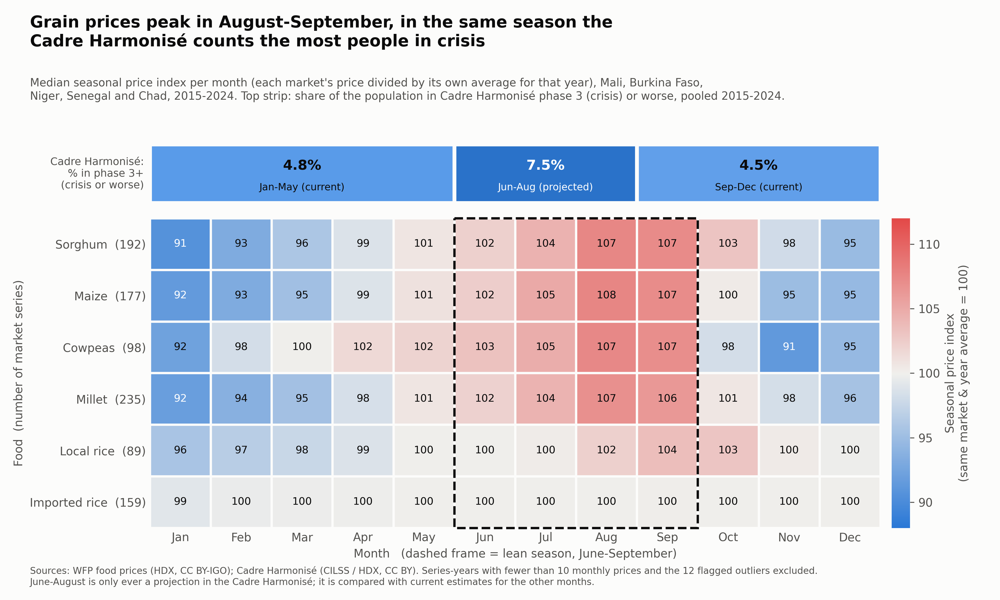
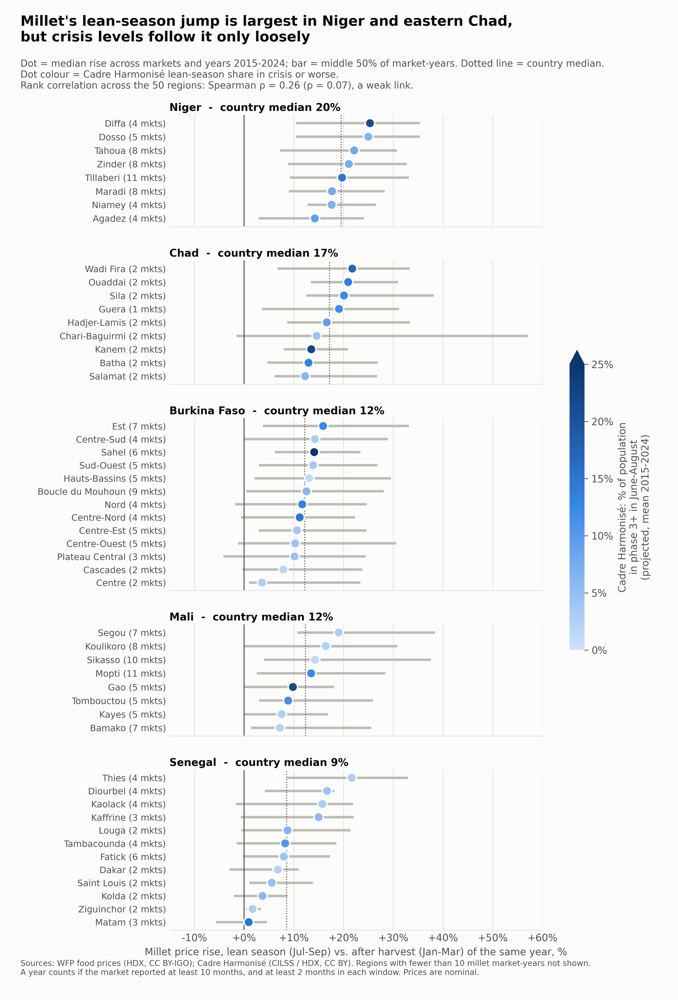

# Person C: Cadre Harmonisé dataset + Research Question 1 (Seasons)

Author: _[your name]_ · Figures and every number below are produced by `a2_seasons/a2_seasons.py`
(run `python a2_seasons/a2_seasons.py` from the project folder; all figures are logged in `a2_seasons/numbers.txt`).

---

## Part 1: For the team report (G1)

### G1 Part 3: Candidate dataset C, Cadre Harmonisé food insecurity

The Cadre Harmonisé (CH) is West and Central Africa's official classification of acute food insecurity,
coordinated by CILSS. It "takes into account various indicators of food and nutrition security outcomes and
the inference of contributing factors to classify and estimate food insecurity" [1]. HDX lists the data source as
"Government, CILSS, IPC". Two analysis cycles are run every year [3]. The February/March cycle comes after the final
agricultural production results and new data on nutrition, household economy and food consumption. The
October/November cycle comes after the harvest forecasts and the nutrition and market surveys. Each cycle
gives a *current* classification and a *projection* for the June–August lean season. HDX gives the current
periods as March–May and October–December, while the file labels them "Jan-May" and "Sep-Dec". The HDX file is a consolidation of the official CH results built by
participants from UN agencies and NGOs (ACF, FAO, OCHA, IFRC, UNICEF, WFP). They compiled the raw Excel
files and the official summary sheets (*fiches de communication*), harmonised place names with standard
geographic codes, and checked the totals against the published figures [1]. It is relevant because it measures the
outcome the price data cannot: how many people are actually going hungry, and when. The raw file has
41,357 rows × 61 columns across 19 countries, reference years 2014–2026 [2]. For each area and period it gives
the total population and the number of people in each phase (1 minimal, 2 stressed, 3 crisis,
4 emergency, 5 famine). It also has the overall phase of the area and outcome indicators labelled "direct evidence":
food consumption groups, dietary diversity (HDDS), hunger scale (HHS), reduced coping strategy index
(rCSI) and livelihood coping strategies [1]. **Limitations:** it is twice-yearly, so it cannot be matched
to prices month by month, and June–August is only ever a projection. Projections are often issued twice for
the same lean season, so rows must be filtered with the `usethisperiod` flag to avoid double counting [1].
The data mixes district rows with finer and coarser rows, which must be de-duplicated (131 rows dropped in our cleaning,
`clean/log.txt`). The direct-evidence indicators are mostly empty: for our 5 countries in 2015–2024 they are
73.7–91.2% missing, while the phase population counts are only 0.8% missing (computed from [2]). Seasons
are missing where analyses were not published (Mali Jan–May 2022, Niger Jan–May 2024, Burkina Faso Sep–Dec
2024). The consolidation notes list where the data differ from the published totals; for our five countries the
documented differences are at most 3.4% [1, Annex 2]. The methodology note [1] only covers data up to March 2023.
**Source:** Food Security and Nutrition Working Group, West and Central Africa (data: Government, CILSS, IPC)
via HDX, licence CC BY,
https://data.humdata.org/dataset/cadre-harmonise

[1] *Consolidation of Cadre Harmonisé data, 2014–March 2023* (PDF on the same HDX page,
`raw/cadre_harmonise/consolidation-of-ch-data-2014-march-2023-en.pdf`).
[2] `raw/cadre_harmonise/cadre_harmonise_caf_ipc_mars26.xlsx`, counted with pandas on 9 Nov 2026.
[3] HDX dataset metadata, "Caveats" and "Source" fields, read via
`https://data.humdata.org/api/3/action/package_show?id=cadre-harmonise` on 9 Nov 2026.

### G1 Part 5: Research question 1 (with the Cadre Harmonisé link)

> **RQ1. How strong is the lean-season rise in staple food prices, how does it differ by food and region, and
> does it coincide with the lean-season peak in the share of people in Cadre Harmonisé phase 3 or worse?**
>
> - RQ1a: In which months and for which foods are prices highest relative to the rest of the year, and do these months match
>   the season when the CH counts the most people in crisis? → Chart A
> - RQ1b: Which regions have the largest millet lean-season rise, and are these the regions where the CH projects
>   the most people in crisis? → Chart B

Variables used: `price_lcu`, `food`, `month_of_year`, `year`, `market_id`, `country`, `region_name`
(`market_month_full.csv`), and `phase35`, `population_analysed`, `share_phase35`, `chtype`, `reference_label`
(`ch_region_season.csv`).

---

## Part 2: Individual Assignment 2 (Exploratory Data Analysis)

### Visualization 1: Heatmap

**Research question (RQ1a):** In which months and for which staple foods are prices highest relative to the
rest of the year, and do these months match the season when the Cadre Harmonisé counts the most people
in crisis?

**Design rationale.** To isolate the *seasonal shape* from inflation and from one-off shocks like 2022, each
price is divided by the average price of the same market and food in the same calendar year (×100). Series-years with
fewer than 10 monthly prices are excluded (92,313 prices in 7,963 market-years remain). The value in each cell is the
**median** over all markets and years, because a few markets with extreme prices would otherwise distort the
mean. A **heatmap** (food × month) fits because the question has two categorical/ordinal dimensions and one
quantitative value, and the reader needs to compare across both at once. The rows are sorted by seasonal
amplitude, so the foods with a strong seasonal cycle (sorghum, maize, cowpeas, millet) come first and the two rices last.
Colour is a **diverging** blue–grey–red scale centred on 100 (the yearly average): blue means cheaper than
usual, red means more expensive. This fits a value whose meaning depends on its direction from a neutral point. Every
cell is labelled with its value, so the exact number does not depend on judging colour. The lean season is
marked with a dashed frame. Above the heatmap, a strip on the **same month axis** shows the Cadre Harmonisé
share of people in phase 3+ for each period (pooled, population-weighted, 2015–2024). Its colour comes from a separate
single-hue blue scale, so that it is not confused with the price scale.

The story is simple and directly useful to a cash-transfer officer: millet, sorghum, maize and cowpeas are about
**8% below their yearly average in January (index 91–92)** and **about 7% above it in August–September (index
106–108)**. Measured within the same year, the median millet price is **14.3% higher in Jul–Sep than in
Jan–Mar** (sorghum 15.3%, maize 15.7%). Over the same months, the share of people in crisis rises from
4.8% (Jan–May) to **7.5% (Jun–Aug, projected)** and falls back to 4.5% (Sep–Dec). Imported rice hardly moves
(index 99–100 all year), and local rice peaks later, in September–October. The projected lean-season share is above the Jan–May share in
every year 2015–2024, and the pattern holds when only region-years with all three analyses are used (4.7%,
7.2%, 4.4%). A price 14–16% higher means the same cash buys about 13% less (1 − 1/1.15), so a transfer that stays
the same through the year buys about 13% less grain exactly when more households are in crisis. **What the design hides:** pooling all
five countries and ten years hides differences between regions (addressed in Chart B) and between years (a
year with a 40% spike and one with no rise both feed into the same median). Strong price shocks are removed on
purpose by the yearly normalisation, so this chart says nothing about price *levels*. The CH June–August value is
a projection, while the other two are current estimates, so the strip compares two different kinds of
estimate. Countries also contribute unequally (Burkina Faso and Mali have many more series than Chad).

### Visualization 2: Dot plot with ranges, faceted by country

**Research question (RQ1b, follow-up):** Which regions have the largest millet lean-season price rise, and
are these the regions where the Cadre Harmonisé projects the most people in crisis?

**Design rationale.** Chart A showed that the lean-season rise is real for grains, so the follow-up asks
*where* it is strongest, and whether it lines up with hunger. Millet was chosen because it is the most widely
reported staple (235 market series, in all five countries). For each market and year the rise is the mean Jul–Sep price divided by
the mean Jan–Mar price of the same year, minus 1 (both windows need at least 2 of 3 months). Each **dot** is the
median over a region's market-years, and the **grey bar** spans the middle 50% (interquartile range). This
shows that the rise varies a lot from year to year, which a single bar would hide. Regions are **faceted by
country** and sorted by the median within each panel, so the reader can find their own region quickly and compare it
with the country median (dotted line). The panels are ordered by country median (Niger 20%, Chad 17%, Burkina Faso
and Mali 12%, Senegal 9%). Position on a common x-axis carries the main quantity, because position is the most
accurately read encoding. The Cadre Harmonisé enters as the **dot colour** (sequential single-hue blue), the mean
projected share in phase 3+ for June–August over 2015–2024. It is the secondary variable, so it gets the weaker channel.
50 regions are shown. The 8 regions with fewer than 10 millet market-years (mostly in Chad) are left out and
named in `numbers.txt`.

The story has two parts. First, the rise clearly differs by region: medians range from about +1% (Matam,
Senegal) to +25% (Diffa and Dosso, Niger), and Niger and eastern Chad (Wadi Fira, Ouaddaï, Sila) are consistently
highest. Second, and less expected, **hunger does not simply follow the seasonal price rise**. The rank correlation
between a region's median rise and its CH lean-season crisis share is weak (Spearman ρ = 0.26, p = 0.065, n = 50).
Several regions with the highest CH shares, such as Sahel in Burkina Faso (29%) and Gao in Mali (21%), have only
average seasonal rises. A possible explanation is that in conflict-affected regions prices are high or
disrupted all year rather than just in the lean season. This is a hypothesis for the conflict question (RQ2), not
something this chart shows. For programme officers this means a seasonal top-up based on the price calendar
alone would miss some of the regions in the worst food crisis. **What the design hides:** the colour shows a
10-year average of the CH share, so it hides how crisis levels changed over time (they roughly doubled after
2019). Regions with 1–2 markets (most of Chad) give less reliable medians. The number of markets is printed
next to each name for this reason. Colour is also harder to compare precisely than position, so the CH relationship
is better read from the stated correlation than from the dots alone. Prices are nominal, and the correlation does
not imply causation.

---

## Checklist before submitting

- [ ] Put your name in the author line above and agree the RQ1 wording with the team.
- [ ] Check that no teammate uses a heatmap or a dot plot (the plan's types: line, map, dumbbell, scatter,
      box plot). The original plan had "small multiples of lines" as chart B for RQ1. Chart B replaces it with
      the Cadre Harmonisé link, so tell the team.
- [ ] Optional: check how the CH direct-evidence indicators were collected in the official CILSS CH manual
      before describing it in more detail (I could not confirm it from the files in `raw/`).
- [ ] Export to PDF (both PNGs are 300 dpi).
